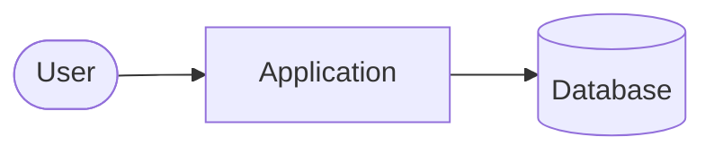

<!-- TEMPLATE: describe the system at the level a new developer needs on day one. -->

## Context

## Components

| Component | Responsibility | Code |
|-----------|----------------|------|

## Data

<!-- Main entities and where they live. -->

## Decisions

Structural choices are recorded as ADRs in `docs/adr/`. Link them from the section they explain.
