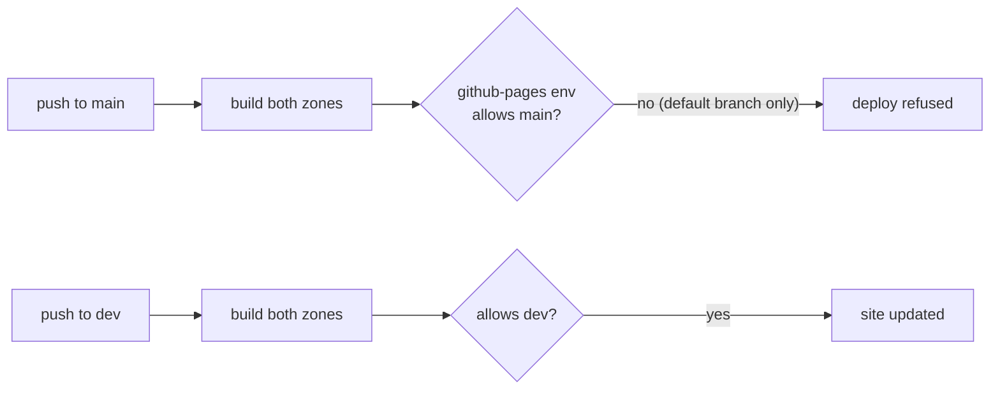

<!-- Study document. Do not merge into main as is: every file of this repository is copied into
each project created from the template. Keep it on its branch, or delete it once acted upon. -->

Audit of `tritriper/project-template` at `b681362` (`main`, PR #1 merged). Every finding is tagged
**observed** (seen in a run, a build or the repository), **deduced** (read from the code and
GitHub's documented behaviour) or **to confirm** (needs a settings page this audit could not see).

## Verdict

The design holds: one rule file, skills shared by every agent, a docs site whose two zones
cannot leak into each other, a release that refuses a tag off `main` or without a CHANGELOG
section. What fails is the **wiring to GitHub settings**: the first docs deployment already failed,
and the post-template checklist omits three settings without which the workflow does not do what
the rules say.

## What was verified

| Check                                                                        | Result                                                |
|------------------------------------------------------------------------------|-------------------------------------------------------|
| Every file read (52 files, lock file sampled)                                | done                                                  |
| `npm ci` + `build:user` + `build:dev` with `DOCS_PAGES_URL` set as in CI     | both build, 19 pages                                  |
| Internal links of the assembled site (`/repo/` + `/repo/dev/`)               | all content links resolve; favicon missing (see L2)   |
| `actionlint` 1.7.12 on `.github/workflows/`                                  | no error (shellcheck not installed: scripts unlinted) |
| PR #1 checks (`CI`, `PR title`)                                              | green                                                 |
| `Docs` run 42371803353 on `main` after merge                                 | **failed** at `deploy`                                |
| Skills discovered by Claude Code through `.claude/skills → ../.ia/skills`    | yes, in this session                                  |
| Release extraction (`awk` in `release.yml`) on a simulated `1.0.0` CHANGELOG | works, one leftover line (see L1)                     |
| Release workflow on a real tag, Pages environment, rulesets, template flag   | **not verified**: no tag, no settings access          |

## Blocking

### B1. The docs deployment fails on `main` (observed, cause deduced)

Run 42371803353: `build` succeeds, `deploy` fails in one second with no runner assigned and no log.
That signature is GitHub refusing the job before it starts, which for `deploy-pages` means the
`github-pages` environment's **deployment branch policy**. GitHub creates that environment with a
rule allowing the default branch only, and the default branch here is not `main` (see B2).

The same trap waits in every project from the template: the checklist sets `dev` as default branch,
so pushes to `main` will be refused. Because each push rebuilds both zones, the user docs would
still refresh, but only on the next push to `dev`, and `main` would show a red cross on every merge.

**Fix:** checklist line *Settings → Environments → github-pages → Deployment branches: add `main`
and `dev`*. To confirm on the run page, which shows the refusal reason as an annotation.

### B2. The template's default branch is the merged agent branch (observed)

`git ls-remote --symref origin HEAD` → `refs/heads/claude/template-repo-structure-ia-vkdlwt`.
"Use this template" copies the default branch only, so new repositories would start on that branch
name (deduced, to confirm). It also explains B1 on this repository.

**Fix:** default branch → `main`, then delete the two merged branches (see Cleanup).

### B3. Single-commit PRs bypass the Conventional Commit check (deduced)

`pr-title.yml` checks the PR title on the premise that it becomes the squash commit. With GitHub's
default squash message, a PR with **one commit** is squashed under that commit's message, not the
title. Branch commits are "free-form" by `git-workflow`, so a non-conventional message reaches `dev`.

**Fix:** checklist line *Settings → General → Pull Requests → squash merging → Default commit
message: Pull request title*.

### B4. The checklist names checks that rulesets cannot select (observed)

The README says "require checks *CI* and *PR title*". Those are workflow names; rulesets list
**check run names**, which PR #1 shows as `Lint, typecheck, test, build`, `Docs build` and
`conventional-commit`.

**Fix:** list the three real names in the checklist (or rename the jobs to something stable and
short, and list those).

## Important

| Id  | Finding                                                                                                                                                                                                                        | Status   | Fix                                                                                                                         |
|-----|--------------------------------------------------------------------------------------------------------------------------------------------------------------------------------------------------------------------------------|----------|-----------------------------------------------------------------------------------------------------------------------------|
| M1  | Placeholder `Makefile` targets succeed: a project can keep a green CI with no lint, type check, test or build, forever.                                                                                                        | observed | make placeholders fail, or add a CI step failing on the `not configured` warning once the project leaves the template phase |
| M2  | No hotfix path: an urgent fix goes through `dev`, so the patch release ships every unreleased feature on `dev`.                                                                                                                | deduced  | `release/vX.Y.(Z+1)` from `main`, cherry-pick the fix, back-merge as usual                                                  |
| M3  | Actions pinned by tag, including third-party ones in privileged workflows (`amannn/…` under `pull_request_target`, `docker/*` with `packages: write`).                                                                         | observed | pin by commit SHA with the tag as comment; Dependabot keeps them updated                                                    |
| M4  | Placeholder checklist incomplete: misses `docs/user/index.mdx` (title, tagline), `CHANGELOG.md` compare links, `board.md`. Template author leftovers: `LICENSE` holder, ADRs `@tritriper` 2026-11-07, "KyberFrog" in ADR 0003. | observed | an init script, or a CI guard failing on `OWNER`, `REPO`, `Project Name`                                                    |
| M5  | The "stack-agnostic" template bakes in a deployment model: Docker image on GHCR, Kubernetes, separate infra repository (ADR 0005, `project.md`, `release.yml`).                                                                | observed | decide: keep as default, or make it an opt-in (see Questions)                                                               |
| M6  | Dependencies pinned one to two days after their release (`astro` 7.4.7 on 2026-11-05, `@astrojs/starlight` 0.42.10 on 2026-11-06); no Dependabot cooldown.                                                                     | observed | `cooldown: { default-days: 7 }` in `dependabot.yml`                                                                         |

## Minor

| Id  | Finding                                                                                                                                           | Status   |
|-----|---------------------------------------------------------------------------------------------------------------------------------------------------|----------|
| L1  | First release notes end with `<!-- Compare links, one per release:` (unclosed comment): the `awk` stops at the links, not at the comment.         | observed |
| L2  | No `docs/site/public/favicon.svg`: Starlight's default favicon is a 404 on every page of both zones.                                              | observed |
| L3  | `0000-template.md` is published in the ADR sidebar as a decision. The content glob already skips `_*.md`: `_template.md` would hide it.           | observed |
| L4  | `AGENTS.md` says every change ships with a CHANGELOG line; `coding-conventions` and the PR template say only user-visible changes. Contradiction. | observed |
| L5  | ADR 0004 justifies Conventional Commits by "automatic version bump or changelog draft"; nothing automates either.                                 | observed |
| L6  | PR title types omit `revert`: GitHub's *Revert* button opens `Revert "…"`, which fails the check. The 72-character limit is not enforced.         | deduced  |
| L7  | CI and docs pin Node 22 (maintenance LTS, end of life April 2027); Node 24 is the active LTS.                                                     | deduced  |
| L8  | `AGENTS.md` repository map omits `Makefile` and `.claude/`.                                                                                       | observed |
| L9  | PR #1 was merged with a merge commit, against the template's own squash rule (history only).                                                      | observed |

## Strengths worth keeping

- `CLAUDE.md` = `@AGENTS.md` and the skills symlink work: no rule is duplicated.
- Two-zone docs: whichever branch is pushed, `/` is always `main` and `/dev/` always `dev`.
- `release.yml` refuses a tag off `main` or missing from the CHANGELOG, and skips the image when
  there is no `Dockerfile` instead of failing.
- `pull_request_target` used without checking out code; least-privilege `permissions` everywhere.
- Content stays at readable paths; one Starlight app builds either zone, OS-independent.

## Cleanup (archived before any deletion)

| Branch                                     | Head SHA  | State                    | Restore                                                                      |
|--------------------------------------------|-----------|--------------------------|------------------------------------------------------------------------------|
| `claude/template-repo-structure-ia-vkdlwt` | `f3c9fb5` | merged in `main` (PR #1) | `git push origin f3c9fb5ae39f01a416363beb38c609e3747e0d14:refs/heads/<name>` |

Deletion needs the default branch moved first (B2) and the maintainer's go.

## Questions

1. **Deployment model (M5).** Keep GHCR + Kubernetes + infra repository as the template default, or
   move it to an optional part? Recommendation: keep it, since `release.yml` already degrades
   gracefully without a `Dockerfile`, but say "opinionated deployment" in the README.
2. **Placeholder CI (M1).** Should a fresh project's CI fail until the `Makefile` is filled?
   Recommendation: fail, with a one-line opt-out, otherwise the warning is never read.
3. **Hotfix (M2).** Add the `main`-based patch path to `git-workflow` and ADR 0004 (new ADR
   superseding it)? Recommendation: yes.
4. **This repository's own flow.** Should the template follow its own `main`/`dev` model, or stay
   trunk-based on `main`? Recommendation: trunk-based, with docs deployed from `main` only.
