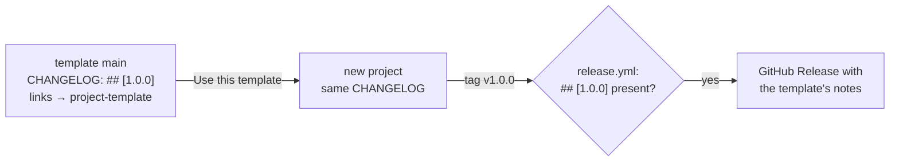

<!-- Study document. Do not merge into main as is: every file of this repository is copied into
each project created from the template. Keep it on its branch, or delete it once acted upon. -->

Audit of `tritriper/project-template`, second pass, on the state after PR #2 and PR #3:
`main` at `6a0c27c` (release v1.0.0 merged), `dev` at `a042145` (default branch). Every finding is
tagged **observed** (seen in a run, a build or the repository), **deduced** (read from the code and
GitHub's documented behaviour) or **to confirm** (needs a settings page this audit could not see).

## Verdict

The first configuration pass fixed what blocked the template itself: the docs deploy works, `dev`
is the default branch, the checklist names the real checks and the Pages environment. Two things
are now in the way of a clean v1.0.0 and of the first project built from it:

1. **The template's own release history ships to every new project** (N1): `CHANGELOG.md` already
   holds `## [1.0.0]` and links to `tritriper/project-template`.
2. **The release is half done** (N2): no `v1.0.0` tag, so no GitHub Release, and no back-merge
   of `main` into `dev`.

## What was verified

| Check                                                                        | Result                                                 |
|------------------------------------------------------------------------------|--------------------------------------------------------|
| Every file read (52 files, lock file sampled), then the diff of PR #2 and #3 | done                                                   |
| `npm ci` + `build:user` + `build:dev` with `DOCS_PAGES_URL` set as in CI     | both build, 19 pages                                   |
| Internal links of the assembled site (`/repo/` + `/repo/dev/`)               | all content links resolve; favicon missing (L2)        |
| `actionlint` 1.7.12 on `.github/workflows/`                                  | no error (shellcheck not installed: scripts unlinted)  |
| `Docs` run 42371803353 on `main`                                             | attempt 1 failed at `deploy`, attempt 2 succeeded      |
| CI and PR title on PR #1, #2, #3                                             | green                                                  |
| Remote branches, default branch, tags                                        | `main`, `dev` (default), audit branch; **no tag**      |
| Release notes extraction on the real `main` CHANGELOG                        | clean (the `<!--` fix works)                           |
| Skills discovered by Claude Code through `.claude/skills → ../.ia/skills`    | yes, in this session                                   |
| Live site, rulesets, Pages environment, "Template repository" flag           | **not verified**: no network route, no settings access |

## Resolved since the first pass

| Id  | Was                                                                   | Now                                                                                 | Status   |
|-----|-----------------------------------------------------------------------|-------------------------------------------------------------------------------------|----------|
| B1  | docs deploy refused on `main` by the `github-pages` environment       | deployment branches documented in the checklist; attempt 2 of the run deployed      | observed |
| B2  | default branch was the merged agent branch                            | `dev` is the default branch; the agent branch is deleted                            | observed |
| B4  | checklist required "CI" and "PR title", names a ruleset cannot select | checklist lists `Lint, typecheck, test, build`, `Docs build`, `conventional-commit` | observed |
| L1  | first release notes ended with an unclosed `<!--`                     | `release.yml` stops at `<!--`; tested on the real CHANGELOG                         | observed |

## Open: important

### N1. The template's release history is copied into every project (observed)

`main` now carries the template's own `## [1.0.0] - 2026-11-07` section, its `Fixed` line about the
setup checklist, and compare links to `tritriper/project-template`. "Use this template" copies all
of it. In the new project, the first `v1.0.0` tag passes the release check (the section exists)
and publishes the **template's** notes as the project's first release.

The same tension applies to the ADRs (dated, signed `@tritriper`) but they are meant to be
inherited; the CHANGELOG is not. See Question 1.

### N2. Release v1.0.0 is half done (observed)

| Step (`git-workflow` → Release procedure)   | State                                                                                 |
|---------------------------------------------|---------------------------------------------------------------------------------------|
| 1. release branch from `dev`                | done, but named `claude/template-repo-structure-ia-vkdlwt`, not `release/v1.0.0`      |
| 2–3. CHANGELOG section, `chore(release)` PR | done (PR #3)                                                                          |
| 4. merge commit into `main`                 | done (`6a0c27c`)                                                                      |
| 5. tag `v1.0.0` on `main`                   | **not done**: no tag on the remote; the CHANGELOG link `releases/tag/v1.0.0` is a 404 |
| 6. back-merge `main` → `dev`                | **not done**: `dev` lacks the `[1.0.0]` heading, the links and the `release.yml` fix  |

Tagging is the maintainer's call. The back-merge must happen before the next feature PR, or the
next release PR into `main` conflicts on `CHANGELOG.md`.

### N3. Nothing gates `dev` any more (observed in the docs, deduced in effect)

The checklist and `git-workflow` now say: ruleset on `dev` blocks deletion only; the maintainer may
push and force-push. Consequences:

- CI, the PR title check (and B3 below) are advisory on `dev`: a red PR can be merged.
- A force-push on `dev` that rewrites history below a back-merge drops it, and `main` and `dev`
  diverge, which is exactly what ADR 0004 *Consequences* warns about.
- `AGENTS.md` still says "Never push to `main` or `dev`" for agents **and humans**; the skill now
  says the maintainer may. The two rule files disagree.

Rulesets have a **bypass list**: a `dev` ruleset requiring PR and checks, with the repository admin
as bypass actor, keeps the maintainer's freedom and still gates agents and contributors.

### B3. Single-commit PRs bypass the Conventional Commit title (deduced, still open)

With GitHub's default squash message, a PR with one commit is squashed under that commit's message,
not the PR title. The checklist still lacks *Settings → General → Pull Requests → squash merging →
Default commit message: Pull request title*.

### Unchanged from the first pass

| Id  | Finding                                                                                                                                                                        | Status   | Fix                                                                          |
|-----|--------------------------------------------------------------------------------------------------------------------------------------------------------------------------------|----------|------------------------------------------------------------------------------|
| M1  | Placeholder `Makefile` targets succeed: a project can keep a green CI with no lint, type check, test or build.                                                                 | observed | make placeholders fail, with a one-line opt-out                              |
| M2  | No hotfix path: an urgent fix goes through `dev`, so the patch release ships every unreleased feature on `dev`.                                                                | deduced  | `release/vX.Y.(Z+1)` from `main`, cherry-pick the fix, back-merge            |
| M3  | Actions pinned by tag, including third-party ones in privileged workflows (`amannn/…` under `pull_request_target`, `docker/*` with `packages: write`).                         | observed | pin by commit SHA with the tag as comment; Dependabot keeps them updated     |
| M4  | Placeholder checklist incomplete (`docs/user/index.mdx`, `board.md`, now the CHANGELOG of N1); author leftovers: `LICENSE` holder, ADRs `@tritriper`, "KyberFrog" in ADR 0003. | observed | an init script, or a CI guard failing on `OWNER`, `REPO`, `project-template` |
| M5  | The "stack-agnostic" template bakes in a deployment model: Docker image on GHCR, Kubernetes, separate infra repository (ADR 0005, `project.md`, `release.yml`).                | observed | keep as default, say so in the README                                        |
| M6  | Dependencies pinned one to two days after their release (`astro` 7.4.7, `@astrojs/starlight` 0.42.10); no Dependabot cooldown.                                                 | observed | `cooldown: { default-days: 7 }` in `dependabot.yml`                          |

## Open: minor

| Id  | Finding                                                                                                                                     | Status   |
|-----|---------------------------------------------------------------------------------------------------------------------------------------------|----------|
| L2  | No `docs/site/public/favicon.svg`: Starlight's default favicon is a 404 on every page of both zones.                                        | observed |
| L3  | `0000-template.md` is published in the ADR sidebar as a decision. The content glob already skips `_*.md`: `_template.md` would hide it.     | observed |
| L4  | `AGENTS.md` asks a CHANGELOG line for every change; `coding-conventions` and the PR template ask it for user-visible changes only.          | observed |
| L5  | ADR 0004 justifies Conventional Commits by "automatic version bump or changelog draft"; nothing automates either.                           | observed |
| L6  | PR title types omit `revert`: GitHub's *Revert* button opens `Revert "…"`, which fails the check. The 72-character limit is not enforced.   | deduced  |
| L7  | CI and docs pin Node 22 (maintenance LTS, end of life April 2027); Node 24 is the active LTS.                                               | deduced  |
| L8  | `AGENTS.md` repository map omits `Makefile` and `.claude/`.                                                                                 | observed |
| L10 | The `/dev/` zone was last built before `dev` existed (fallback to `main`); same content today, it refreshes on the next push under `docs/`. | observed |
| L11 | One agent branch carried PR #1, #2 and #3, including the release; `release/vX.Y.Z` naming was not used.                                     | observed |

## Strengths worth keeping

- `CLAUDE.md` = `@AGENTS.md` and the skills symlink work: no rule is duplicated.
- Two-zone docs: whichever branch is pushed, `/` is always `main` and `/dev/` always `dev`.
- `release.yml` refuses a tag off `main` or missing from the CHANGELOG, and skips the image when
  there is no `Dockerfile` instead of failing.
- `pull_request_target` used without checking out code; least-privilege `permissions` everywhere.
- The first fixes were made the way the rules say: PR #2 shipped its CHANGELOG line, release
  PR #3 used a merge commit.

## Questions

1. **Template history vs seed CHANGELOG (N1).** Options: (a) a checklist line "reset
   `CHANGELOG.md`" plus the M4 guard; (b) keep the template's history out of `CHANGELOG.md`
   (GitHub Releases only, or a separate file that `release.yml` reads in this repository).
   Recommendation: (b), because a forgotten reset publishes wrong notes; (a) only if you want the
   template to dogfood its own release workflow unchanged.
2. **Gate on `dev` (N3).** Require PR and the three checks on `dev`, with yourself as bypass actor,
   and block force-push? Recommendation: yes; it keeps your direct pushes and gates agents.
3. **Placeholder CI (M1).** Should a fresh project's CI fail until the `Makefile` is filled?
   Recommendation: fail, with a one-line opt-out.
4. **Hotfix (M2).** Add the `main`-based patch path to `git-workflow` with a new ADR superseding
   0004? Recommendation: yes, together with the `dev` ruleset of Question 2.
5. **Deployment model (M5).** Keep GHCR + Kubernetes + infra repository as the default?
   Recommendation: keep, and say "opinionated deployment" in the README.
